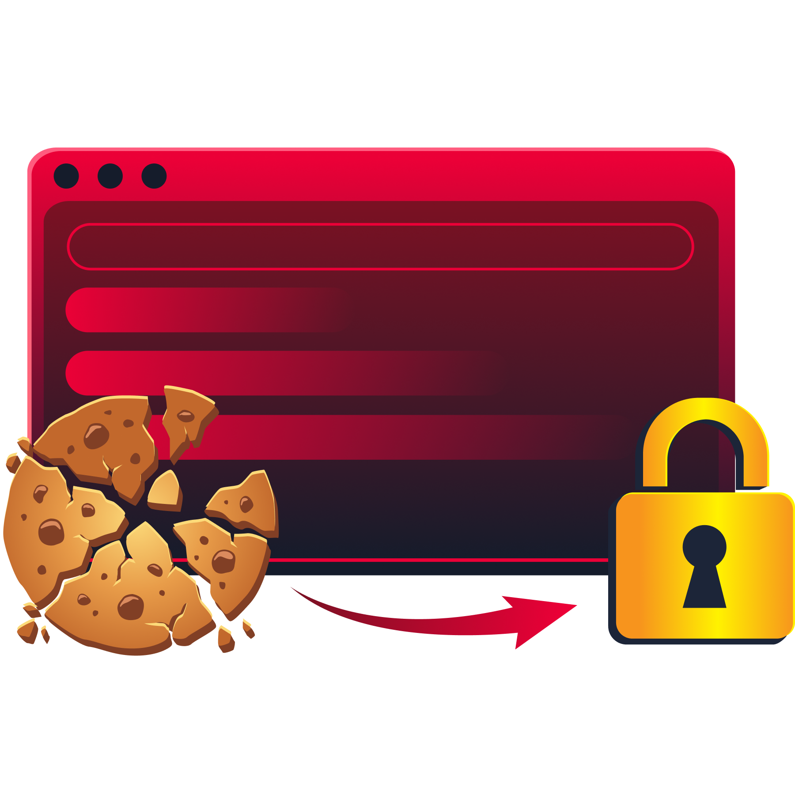

# CSRF Introduction



Section 07 · Web Application Vulnerabilities I · Room 02

## Task 1 — Introduction

When an employee signs in to StaffHub, the browser stores a cookie that identifies their session. Depending on the cookie settings, the browser can include it with a request initiated by another site. If StaffHub accepts that request and changes the employee’s email address without the employee choosing to do so, that is cross-site request forgery (CSRF).

### Learning objectives

- Identify which features change account data. In StaffHub, viewing a profile reads existing data, while saving an email address or a profile preference changes it.
- Explain how an HTML form on one site can submit a request to another.
- Describe the role of a CSRF token in protecting an account update and why a weak token can leave that update exposed.

### Lab setup

1. Start the target VM. Use the TryHackMe AttackBox as the second machine, or connect your own machine through the TryHackMe VPN.
2. Give the target about 1–2 minutes to initialize. When using the AttackBox in split view, switch between machines with the tabs at the bottom.
3. If Chrome displays a keyring prompt in the VM, select **Cancel** to continue.
4. In the lab browser, open `http://staffhub.thm:8080` using the hostname supplied by the room and sign in with the provided training account. The room uses the AttackBox to edit the example files and the target VM for the employee’s signed-in browser.

## Task 2 — What is CSRF?

Imagine an employee leaves StaffHub open in one tab and visits another website in a second tab. A page in the second tab can cause the browser to send a request to StaffHub. If the browser’s cookie settings allow it, the request can carry the employee’s session cookie. StaffHub can then recognize the account even though the employee never opened its settings form.

Cross-site request forgery occurs if StaffHub accepts that request and makes a change the employee never chose. An unwanted email change, for example, could send future account notices to a different inbox. The impact depends on what the signed-in account can do. In another application, an unwanted request could change a security preference or initiate a payment.

## Task 3 — Why CSRF Works

A request can start on one site and arrive at another. When cookie rules permit, the browser sends StaffHub’s session cookie directly to StaffHub. The page that started the request never needs to read the cookie or know the employee’s password.

Three conditions explain how an unwanted profile edit could take effect in the room’s example.

1. The employee is still signed in, and the request reaches StaffHub with a valid session cookie.
2. The employee’s account has permission to save the edit, such as changing a profile preference.
3. StaffHub treats the session as sufficient to save the change and skips checking whether the request came from a trusted page.

## Task 4 — Finding CSRF Vulnerabilities

A CSRF review starts with what the server does when someone uses a feature. Opening StaffHub’s settings displays the employee’s email address. Saving a replacement updates the account record. Other examples worth reviewing include changing a password or security preference, linking an account, and adding or removing a payee.

### GET and POST

`GET` is intended for reading data, and forms often use `POST` to save edits. If a handler writes to an account, either method leaves the server with the same question. What evidence ties this update to a trusted page? For an email change, the server could validate a CSRF token tied to the employee’s session before saving the new address.

## Task 5 — Exploitation Using an HTML Form

### StaffHub’s email form

On the employee’s **Settings** page, **Update Email** submits the new address in the body of a `POST` request. These are the visible controls, simplified from the room’s form.

```html
<label for="email">New Email Address</label>
<input id="email" type="email" name="email" required>
<button type="submit">Update Email</button>
```

The label’s `for` attribute matches the input’s `id`. The browser uses `name="email"` as the field name in the submission. The `required` and `type="email"` attributes check that the employee entered something shaped like an address. An unwanted replacement address can pass both checks. In the room, the address is the only form value and the server accepts the edit under the existing login session.

### Room shell commands

```bash
cd /var/www/html
nano settings.html
```

`cd` sets the shell’s working directory to `/var/www/html`. `nano` opens `settings.html` there for editing. If the file is new, Nano creates it on the first save.

### What the second page demonstrated

The room’s second example uses JavaScript to initiate an email change from another page while the employee is signed in. The browser then returns to StaffHub’s **Settings** page. The replacement address displayed in the employee’s profile shows that StaffHub saved the change even though the employee never selected **Update Email** in the portal.

## Task 6 — Exploitation over Weak Tokens

### The hidden field in the role form

StaffHub’s **Update Role** form includes a value that travels with the submission even though it has no visible control on the settings page. The abbreviated field below uses a placeholder for the token value.

```html
<input type="hidden" name="csrf_token" value="TOKEN_PLACEHOLDER">
```

The room uses CyberChef in the browser to show that the value represents existing account information. Putting predictable information in a reversible format adds no randomness. Even two employees with the same role should receive independent tokens for their sessions, and the server should validate the submitted token before saving a role change.

### Room shell commands

```bash
cd /var/www/html
nano role.html
```

The room uses a separate file for the role example. `nano role.html` opens that file in the working directory selected by `cd`.

### What the banner example demonstrated

The room’s banner example shows a signed-in employee interacting with an image on a separate page. StaffHub associates the request with that employee’s session and accepts the predictable token. The resulting change from administrator to staff reduces the account’s permissions. **Settings** contains the role form, and the room directs the learner to the **Dashboard** to check the outcome.

## Task 7 — Best Practices

| Review area | What to check |
| --- | --- |
| Account changes | Prioritize actions with consequences for the user, such as saving a new email address, changing a password or role, or transferring money. |
| CSRF tokens | Where tokens are used, check that the server requires an unpredictable value tied to the current session and rejects a missing or invalid token. |
| HTTP methods | Check that `GET` only retrieves data. For edits submitted with `POST`, identify the server-side check that protects the update. |
| Requests from other sites | A protection test should confirm that the server rejects an unauthorized cross-site update before it changes the saved account record. |
| Session cookies | Review when the browser includes the login cookie on cross-site requests and what additional check StaffHub makes before saving an edit. |

A token can remain valid throughout one session. Seeing the same value twice in that session is expected for a per-session design. A value shared across independent sessions or derived from predictable account data warrants review. [OWASP CSRF Prevention Cheat Sheet](https://cheatsheetseries.owasp.org/cheatsheets/Cross-Site_Request_Forgery_Prevention_Cheat_Sheet.html#synchronizer-token-pattern)

## Task 8 — Conclusion

StaffHub recognized the signed-in employee in both room examples. For an email change, the portal treated the session cookie as sufficient approval. For a role change, it checked a token whose value was predictable. Both checks allowed StaffHub to save an update the employee never chose.

For these settings, the server can require an unpredictable token tied to the employee’s session before saving an update. A reviewer can verify the protection by checking that StaffHub rejects a missing or invalid token before it changes the email address or role on file.

[TryHackMe room](https://tryhackme.com/room/csrfintroduction) · [Back to Section 07](./README.md)
